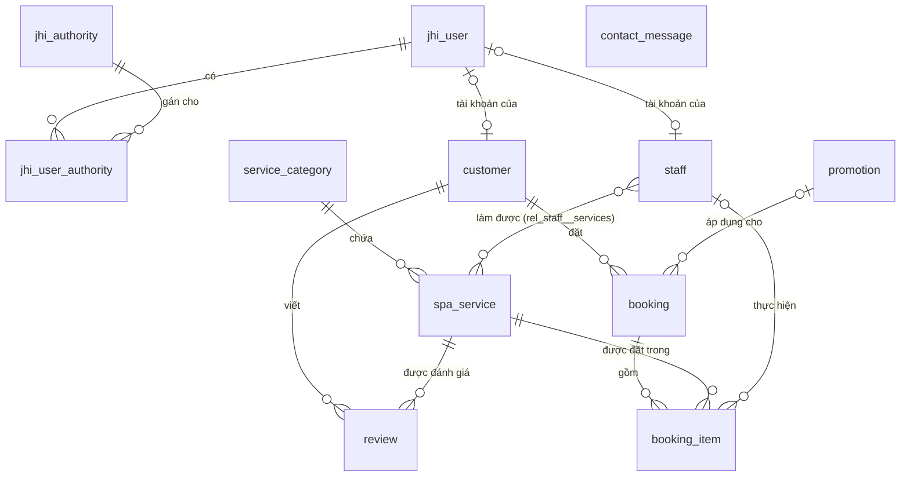
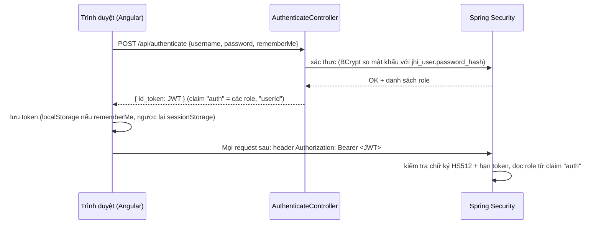

# 01. Database, quan hệ bảng & phân quyền

> Nguồn sự thật: [`jhipster-jdl.jdl`](../jhipster-jdl.jdl) (thiết kế) và `src/main/resources/config/liquibase/` (schema thật trong MySQL).
> Khi sửa tài liệu này mà không sửa hai nơi trên thì tài liệu sẽ sai — luôn sửa JDL trước.

## 1. Sơ đồ quan hệ (ER)

## 2. Danh sách bảng

| Bảng                  | Entity Java       | Ý nghĩa                               | Cột chính                                                                                                                                                 |
| --------------------- | ----------------- | ------------------------------------- | --------------------------------------------------------------------------------------------------------------------------------------------------------- |
| `jhi_user`            | `User`            | Tài khoản đăng nhập (JHipster có sẵn) | `login` (unique), `password_hash`, `email`, `activated`, `lang_key`                                                                                       |
| `jhi_authority`       | `Authority`       | Danh sách role                        | `name` (PK)                                                                                                                                               |
| `jhi_user_authority`  | — (bảng nối)      | User ↔ Role                          | `user_id`, `authority_name`                                                                                                                               |
| `service_category`    | `ServiceCategory` | Danh mục dịch vụ                      | `name`, `slug` (unique), `display_order`, `active`                                                                                                        |
| `spa_service`         | `SpaService`      | Dịch vụ spa                           | `name`, `slug` (unique), `price`, `sale_price`, `duration_minutes`, `featured`, `active`, `category_id`                                                   |
| `customer`            | `Customer`        | Hồ sơ khách hàng                      | `full_name`, `phone` (unique), `email`, `gender`, `date_of_birth`, `user_id` (unique, có thể null)                                                        |
| `staff`               | `Staff`           | Kỹ thuật viên / nhân viên             | `full_name`, `position`, `active`, `user_id` (unique, có thể null)                                                                                        |
| `rel_staff__services` | — (bảng nối)      | Nhân viên ↔ dịch vụ làm được         | `staff_id`, `services_id`                                                                                                                                 |
| `booking`             | `Booking`         | Lịch hẹn                              | `code` (unique), `start_time`, `end_time`, `status`, `total_amount`, `discount_amount`, `payment_status`, `payment_method`, `customer_id`, `promotion_id` |
| `booking_item`        | `BookingItem`     | Dịch vụ trong lịch hẹn                | `price`, `quantity`, `duration_minutes`, `booking_id`, `service_id`, `staff_id`                                                                           |
| `promotion`           | `Promotion`       | Mã khuyến mãi                         | `code` (unique), `discount_percent`, `discount_amount`, `start_date`, `end_date`, `active`                                                                |
| `review`              | `Review`          | Đánh giá dịch vụ                      | `rating` (1–5), `comment`, `approved`, `customer_id`, `service_id`                                                                                        |
| `contact_message`     | `ContactMessage`  | Liên hệ từ website                    | `full_name`, `phone`, `email`, `message`, `handled`                                                                                                       |

## 3. Chi tiết quan hệ (khóa ngoại)

| Quan hệ                      | Kiểu       | Cột FK                    | Bắt buộc                                  | Hiển thị trên form            |
| ---------------------------- | ---------- | ------------------------- | ----------------------------------------- | ----------------------------- |
| Customer → User              | OneToOne   | `customer.user_id`        | Không (khách vãng lai không có tài khoản) | `login`                       |
| Staff → User                 | OneToOne   | `staff.user_id`           | Không                                     | `login`                       |
| SpaService → ServiceCategory | ManyToOne  | `spa_service.category_id` | **Có**                                    | `name`                        |
| Staff ↔ SpaService          | ManyToMany | `rel_staff__services`     | —                                         | `name` (Staff là phía sở hữu) |
| Booking → Customer           | ManyToOne  | `booking.customer_id`     | **Có**                                    | `fullName`                    |
| Booking → Promotion          | ManyToOne  | `booking.promotion_id`    | Không                                     | `code`                        |
| BookingItem → Booking        | ManyToOne  | `booking_item.booking_id` | **Có**                                    | `code`                        |
| BookingItem → SpaService     | ManyToOne  | `booking_item.service_id` | **Có**                                    | `name`                        |
| BookingItem → Staff          | ManyToOne  | `booking_item.staff_id`   | Không                                     | `fullName`                    |
| Review → Customer            | ManyToOne  | `review.customer_id`      | **Có**                                    | `fullName`                    |
| Review → SpaService          | ManyToOne  | `review.service_id`       | **Có**                                    | `name`                        |

### Lưu ý khi xóa (không có cascade)

Code JHipster sinh ra **không cascade xóa**. Xóa bản ghi cha khi còn bản ghi con sẽ lỗi khóa ngoại (HTTP 500 / 400):

| Muốn xóa          | Phải xử lý trước                                                                       |
| ----------------- | -------------------------------------------------------------------------------------- |
| `ServiceCategory` | Chuyển hoặc xóa các `SpaService` thuộc danh mục                                        |
| `SpaService`      | Các `BookingItem`, `Review` đang tham chiếu                                            |
| `Customer`        | Các `Booking`, `Review` của khách                                                      |
| `Booking`         | Các `BookingItem` của lịch hẹn                                                         |
| `Staff`           | Các `BookingItem` đang gán nhân viên (bảng nối `rel_staff__services` Hibernate tự xóa) |
| `Promotion`       | Các `Booking` đang dùng mã                                                             |

Khuyến nghị nghiệp vụ: với dịch vụ, danh mục, nhân viên, khuyến mãi → **ẩn bằng `active = false`** thay vì xóa.

## 4. Enum

| Enum            | Giá trị                                                                            | Dùng ở                   |
| --------------- | ---------------------------------------------------------------------------------- | ------------------------ |
| `Gender`        | `MALE`, `FEMALE`, `OTHER`                                                          | `customer.gender`        |
| `BookingStatus` | `PENDING` → `CONFIRMED` → `IN_PROGRESS` → `COMPLETED`; hoặc `CANCELLED`, `NO_SHOW` | `booking.status`         |
| `PaymentStatus` | `UNPAID`, `PAID`, `REFUNDED`                                                       | `booking.payment_status` |
| `PaymentMethod` | `CASH`, `BANK_TRANSFER`, `CARD`, `E_WALLET`                                        | `booking.payment_method` |

## 5. Phân quyền (role)

### 5.1 Các role

| Role              | Ai có            | Cách được gán                                      |
| ----------------- | ---------------- | -------------------------------------------------- |
| (không đăng nhập) | Khách vãng lai   | —                                                  |
| `ROLE_USER`       | Mọi tài khoản    | Mặc định của JHipster                              |
| `ROLE_CUSTOMER`   | Khách tự đăng ký | Tự động khi đăng ký (`UserService.registerUser`)   |
| `ROLE_STAFF`      | Nhân viên        | Admin gán trong _Administration → User management_ |
| `ROLE_ADMIN`      | Quản lý          | Admin gán                                          |

Tài khoản mẫu (môi trường dev): `admin/admin` (ADMIN, USER), `user/user` (USER, CUSTOMER).

> Role mới được thêm bằng changeset [`20261011120000_added_spa_authorities.xml`](../src/main/resources/config/liquibase/changelog/20261011120000_added_spa_authorities.xml).
> **Không sửa** `liquibase/data/authority.csv` — database đã chạy sẽ báo lỗi checksum.

### 5.2 Ma trận quyền API

✅ được phép · ❌ bị chặn (401 nếu chưa đăng nhập, 403 nếu thiếu quyền) · 🔒 chỉ dữ liệu của chính mình

| API                                                                                 | Khách vãng lai    | CUSTOMER                                               | STAFF             | ADMIN       |
| ----------------------------------------------------------------------------------- | ----------------- | ------------------------------------------------------ | ----------------- | ----------- |
| `GET /api/service-categories`, `/api/spa-services`, `/api/promotions`, `/api/staff` | ✅                | ✅                                                     | ✅                | ✅          |
| `POST/PUT/PATCH/DELETE` các API trên                                                | ❌                | ❌                                                     | ❌                | ✅          |
| `GET /api/reviews`                                                                  | ✅ (chỉ đã duyệt) | ✅ (chỉ đã duyệt)                                      | ✅ (chỉ đã duyệt) | ✅ (tất cả) |
| `POST /api/reviews`                                                                 | ❌                | 🔒 (tự gán khách, `approved=false`)                    | ❌                | ✅          |
| `PUT/PATCH/DELETE /api/reviews`                                                     | ❌                | ❌                                                     | ❌                | ✅          |
| `POST /api/contact-messages`                                                        | ✅                | ✅                                                     | ✅                | ✅          |
| `GET/PUT/PATCH/DELETE /api/contact-messages`                                        | ❌                | ❌                                                     | ❌                | ✅          |
| `/api/customers/**`                                                                 | ❌                | ❌                                                     | ✅                | ✅          |
| `GET /api/bookings/**`                                                              | ❌                | 🔒                                                     | ✅                | ✅          |
| `POST /api/bookings`                                                                | ❌                | 🔒 (tự gán khách, `PENDING`, `UNPAID`, bỏ qua số tiền) | ✅                | ✅          |
| `PUT/PATCH/DELETE /api/bookings/**`                                                 | ❌                | ❌                                                     | ✅                | ✅          |
| `/api/booking-items/**`                                                             | ❌                | ❌                                                     | ✅                | ✅          |
| `/api/admin/**`, `/management/**`, `/v3/api-docs/**`                                | ❌                | ❌                                                     | ❌                | ✅          |
| `/api/authenticate`, `/api/register`, `/api/activate`, reset mật khẩu               | ✅                | ✅                                                     | ✅                | ✅          |

### 5.3 Quyền được kiểm tra ở đâu

| Tầng              | File                                                                                                                                                                                     | Kiểm tra gì                                                                                                            |
| ----------------- | ---------------------------------------------------------------------------------------------------------------------------------------------------------------------------------------- | ---------------------------------------------------------------------------------------------------------------------- |
| URL (backend)     | [`SecurityConfiguration.java`](../src/main/java/com/mycompany/myapp/config/SecurityConfiguration.java)                                                                                   | Role nào được gọi URL + HTTP method nào. **Luật đặt trên thắng luật đặt dưới** — luật cụ thể phải đứng trước `/api/**` |
| Dữ liệu (backend) | [`BookingResource.java`](../src/main/java/com/mycompany/myapp/web/rest/BookingResource.java), [`ReviewResource.java`](../src/main/java/com/mycompany/myapp/web/rest/ReviewResource.java) | CUSTOMER chỉ thấy / tạo dữ liệu của chính mình (`isCustomerOnly()`, `currentCustomerId()`)                             |
| Route (frontend)  | [`entity.routes.ts`](../src/main/webapp/app/entities/entity.routes.ts)                                                                                                                   | `data.authorities` + `UserRouteAccessService`                                                                          |
| Menu (frontend)   | [`navbar.component.html`](../src/main/webapp/app/layouts/navbar/navbar.component.html)                                                                                                   | `*jhiHasAnyAuthority` ẩn menu                                                                                          |

> Frontend chỉ để **ẩn giao diện**. Bảo mật thật nằm ở backend — mọi luật mới phải thêm vào `SecurityConfiguration` trước.

### 5.4 Luồng đăng nhập JWT

- Khóa ký JWT: `jhipster.security.authentication.jwt.base64-secret` trong `application-*.yml`. **Đổi khóa này ở môi trường production.**
- Hạn token: `token-validity-in-seconds` (mặc định 1 ngày), `token-validity-in-seconds-for-remember-me` (30 ngày).
- Role nằm trong token → **đổi role của user thì user phải đăng nhập lại** mới có hiệu lực.

## 6. Hạn chế hiện tại (cần làm tiếp)

1. Tài khoản tự đăng ký chưa tự tạo hồ sơ `Customer` → CUSTOMER chưa đặt lịch được (API trả `nocustomerprofile`).
2. CUSTOMER không gọi được `/api/booking-items` → chưa thêm dịch vụ vào lịch hẹn được; cần API đặt lịch riêng (tạo `Booking` + `BookingItem` trong 1 request, tính tiền ở server).
3. Chưa kiểm tra trùng lịch nhân viên / giờ mở cửa.
