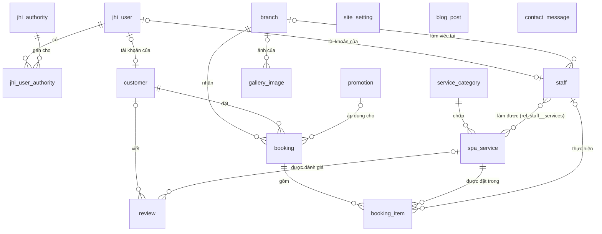
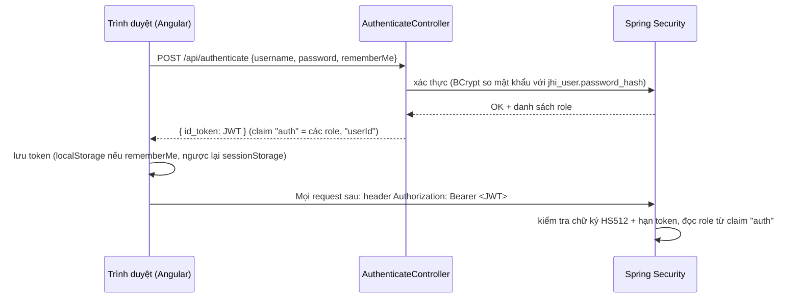

# 01. Database, quan hệ bảng & phân quyền

> Nguồn sự thật: [`jhipster-jdl.jdl`](../jhipster-jdl.jdl) (thiết kế) và `src/main/resources/config/liquibase/` (schema thật trong MySQL).
> Khi sửa tài liệu này mà không sửa hai nơi trên thì tài liệu sẽ sai — luôn sửa JDL trước.

## 1. Sơ đồ quan hệ (ER)

## 2. Danh sách bảng

Trường **song ngữ** luôn đi theo cặp `..._vi` / `..._en`. Website hiển thị cột theo ngôn ngữ trong URL (`/vi`, `/en`); cột `_en` để trống thì dùng `_vi`.

| Bảng                  | Entity Java       | Ý nghĩa                                         | Cột chính                                                                                                                                                                                                                                                 |
| --------------------- | ----------------- | ----------------------------------------------- | --------------------------------------------------------------------------------------------------------------------------------------------------------------------------------------------------------------------------------------------------------- |
| `jhi_user`            | `User`            | Tài khoản đăng nhập (JHipster có sẵn)           | `login` (unique), `password_hash`, `email`, `activated`, `lang_key`                                                                                                                                                                                       |
| `jhi_authority`       | `Authority`       | Danh sách role                                  | `name` (PK)                                                                                                                                                                                                                                               |
| `jhi_user_authority`  | — (bảng nối)      | User ↔ Role                                    | `user_id`, `authority_name`                                                                                                                                                                                                                               |
| `site_setting`        | `SiteSetting`     | Cài đặt website — **chỉ dùng bản ghi đầu tiên** | tên spa, logo, slogan, hero (ảnh/video), nhạc nền, giới thiệu, 3 điểm nổi bật, hotline, email, WhatsApp, Zalo, mạng xã hội, giờ mở cửa, meta description, chính sách (đều song ngữ nếu là văn bản)                                                        |
| `branch`              | `Branch`          | Cơ sở / chi nhánh                               | `name_vi/en`, `slug` (unique), `address_vi/en`, `phone`, `whatsapp`, `zalo`, `open_time`, `close_time`, `last_booking_time` (HH:mm), `capacity` (số khách phục vụ cùng lúc), `map_embed_url`, `map_direction_url`, `image_url`, `display_order`, `active` |
| `service_category`    | `ServiceCategory` | Nhóm dịch vụ                                    | `name_vi/en`, `slug` (unique), `description_vi/en`, `image_url`, `display_order`, `active`                                                                                                                                                                |
| `spa_service`         | `SpaService`      | Dịch vụ                                         | `name_vi/en`, `slug` (unique), `short_description_vi/en`, `description_vi/en`, `benefits_vi/en`, `notes_vi/en` (mỗi dòng 1 ý), `price`, `sale_price`, `price_max`, `duration_minutes`, `image_url`, `featured`, `display_order`, `active`, `category_id`  |
| `customer`            | `Customer`        | Hồ sơ khách                                     | `full_name`, `phone` (unique), `email`, `gender`, `date_of_birth`, `user_id` (unique, có thể null)                                                                                                                                                        |
| `staff`               | `Staff`           | Kỹ thuật viên                                   | `full_name`, `position`, `avatar_url`, `active`, `user_id`, `branch_id`                                                                                                                                                                                   |
| `rel_staff__services` | — (bảng nối)      | Nhân viên ↔ dịch vụ làm được                   | `staff_id`, `services_id`                                                                                                                                                                                                                                 |
| `booking`             | `Booking`         | Lịch hẹn                                        | `code` (unique), `start_time`, `end_time`, `number_of_people`, `status`, `source`, `total_amount`, `discount_amount`, `payment_status`, `payment_method`, `note`, `branch_id`, `customer_id`, `promotion_id`                                              |
| `booking_item`        | `BookingItem`     | Dịch vụ trong lịch hẹn                          | `price` (đơn giá lúc đặt), `quantity` (= số người), `duration_minutes`, `booking_id`, `service_id`, `staff_id`                                                                                                                                            |
| `promotion`           | `Promotion`       | Mã khuyến mãi                                   | `code` (unique), `discount_percent`, `discount_amount`, `start_date`, `end_date`, `active`                                                                                                                                                                |
| `review`              | `Review`          | Đánh giá                                        | `author_name`, `rating` (1–5), `comment`, `video_url` (YouTube/TikTok), `review_date`, `approved`, `featured`, `customer_id`, `service_id` (đều có thể null)                                                                                              |
| `gallery_image`       | `GalleryImage`    | Ảnh thư viện                                    | `image_url`, `caption_vi/en`, `alt_vi/en`, `width`, `height`, `display_order`, `active`, `branch_id`                                                                                                                                                      |
| `blog_post`           | `BlogPost`        | Tin tức / blog                                  | `title_vi/en`, `slug` (unique), `excerpt_vi/en`, `content_vi/en`, `cover_image_url`, `category`, `published`, `published_at`                                                                                                                              |
| `contact_message`     | `ContactMessage`  | Liên hệ từ website                              | `full_name`, `phone`, `email`, `message`, `handled`, `created_date`                                                                                                                                                                                       |

## 3. Chi tiết quan hệ (khóa ngoại)

| Quan hệ                      | Kiểu       | Cột FK                    | Bắt buộc                                          | Hiển thị trên form              |
| ---------------------------- | ---------- | ------------------------- | ------------------------------------------------- | ------------------------------- |
| Customer → User              | OneToOne   | `customer.user_id`        | Không (khách đặt qua website không cần tài khoản) | `login`                         |
| Staff → User                 | OneToOne   | `staff.user_id`           | Không                                             | `login`                         |
| Staff → Branch               | ManyToOne  | `staff.branch_id`         | Không                                             | `nameVi`                        |
| SpaService → ServiceCategory | ManyToOne  | `spa_service.category_id` | **Có**                                            | `nameVi`                        |
| Staff ↔ SpaService          | ManyToMany | `rel_staff__services`     | —                                                 | `nameVi` (Staff là phía sở hữu) |
| Booking → Branch             | ManyToOne  | `booking.branch_id`       | **Có**                                            | `nameVi`                        |
| Booking → Customer           | ManyToOne  | `booking.customer_id`     | **Có**                                            | `fullName`                      |
| Booking → Promotion          | ManyToOne  | `booking.promotion_id`    | Không                                             | `code`                          |
| BookingItem → Booking        | ManyToOne  | `booking_item.booking_id` | **Có**                                            | `code`                          |
| BookingItem → SpaService     | ManyToOne  | `booking_item.service_id` | **Có**                                            | `nameVi`                        |
| BookingItem → Staff          | ManyToOne  | `booking_item.staff_id`   | Không                                             | `fullName`                      |
| Review → Customer            | ManyToOne  | `review.customer_id`      | Không                                             | `fullName`                      |
| Review → SpaService          | ManyToOne  | `review.service_id`       | Không                                             | `nameVi`                        |
| GalleryImage → Branch        | ManyToOne  | `gallery_image.branch_id` | Không                                             | `nameVi`                        |

### Lưu ý khi xóa (không có cascade)

Code JHipster sinh ra **không cascade xóa**. Xóa bản ghi cha khi còn bản ghi con sẽ lỗi khóa ngoại (HTTP 500):

| Muốn xóa          | Phải xử lý trước                                                      |
| ----------------- | --------------------------------------------------------------------- |
| `Branch`          | Các `Booking` của cơ sở (thường **không xóa** — đặt `active = false`) |
| `ServiceCategory` | Chuyển hoặc xóa các `SpaService` thuộc danh mục                       |
| `SpaService`      | Các `BookingItem`, `Review` đang tham chiếu                           |
| `Customer`        | Các `Booking`, `Review` của khách                                     |
| `Booking`         | Các `BookingItem` của lịch hẹn                                        |
| `Staff`           | Các `BookingItem` đang gán nhân viên                                  |
| `Promotion`       | Các `Booking` đang dùng mã                                            |

Khuyến nghị: cơ sở, danh mục, dịch vụ, nhân viên, khuyến mãi, ảnh → **ẩn bằng `active = false`**; bài viết → `published = false`; đánh giá → `approved = false`.

## 4. Enum

| Enum            | Giá trị                                                                            | Dùng ở                   |
| --------------- | ---------------------------------------------------------------------------------- | ------------------------ |
| `Gender`        | `MALE`, `FEMALE`, `OTHER`                                                          | `customer.gender`        |
| `BookingStatus` | `PENDING` → `CONFIRMED` → `IN_PROGRESS` → `COMPLETED`; hoặc `CANCELLED`, `NO_SHOW` | `booking.status`         |
| `BookingSource` | `WEBSITE` (luồng 7 bước), `QUICK` (đặt nhanh), `ADMIN`, `PHONE`, `WALK_IN`         | `booking.source`         |
| `PaymentStatus` | `UNPAID`, `PAID`, `REFUNDED`                                                       | `booking.payment_status` |
| `PaymentMethod` | `CASH`, `BANK_TRANSFER`, `CARD`, `E_WALLET`                                        | `booking.payment_method` |
| `BlogCategory`  | `NEWS`, `EVENT`, `REVIEW`, `TIPS`                                                  | `blog_post.category`     |

## 5. Quy tắc đặt lịch online (khách vãng lai)

Cài đặt trong [`PublicBookingService`](../src/main/java/com/mycompany/myapp/service/PublicBookingService.java):

| Quy tắc                            | Giá trị                                                                                                                        |
| ---------------------------------- | ------------------------------------------------------------------------------------------------------------------------------ |
| Khung giờ                          | Mỗi 15 phút, từ `branch.open_time` đến `branch.last_booking_time` (vd 10:00 → 21:30)                                           |
| Đặt trước tối thiểu                | 30 phút (giờ trước đó hiện là "đã qua")                                                                                        |
| Đặt trước tối đa                   | 60 ngày                                                                                                                        |
| Còn chỗ khi                        | Trong suốt thời lượng (tổng phút các dịch vụ), ở **mọi mốc 15 phút**: số khách đang phục vụ + số khách mới ≤ `branch.capacity` |
| Lịch không chiếm chỗ               | `CANCELLED`, `NO_SHOW`                                                                                                         |
| Lịch admin tạo không có `end_time` | Coi như kéo dài 60 phút                                                                                                        |
| Giá                                | Server tính: (`sale_price` nếu có, ngược lại `price`) × số người, cho từng dịch vụ. Không dùng giá client gửi                  |
| Khách                              | Tìm `customer` theo số điện thoại đã chuẩn hóa (`0xxxxxxxxx`); chưa có thì tạo mới                                             |
| Mã đặt lịch                        | `AL` + `yyMMdd` + 4 ký tự (bỏ 0/O/1/I), vd `AL261011K7QM`                                                                      |
| Trạng thái ban đầu                 | `status = PENDING`, `payment_status = UNPAID`, `source = WEBSITE` hoặc `QUICK`                                                 |
| Chống trùng chỗ                    | Kiểm tra + lưu nằm trong `synchronized` (đủ cho 1 máy chủ)                                                                     |

## 6. Phân quyền (role)

### 6.1 Các role

| Role              | Ai có                      | Cách được gán                                      |
| ----------------- | -------------------------- | -------------------------------------------------- |
| (không đăng nhập) | Khách xem website          | —                                                  |
| `ROLE_USER`       | Mọi tài khoản              | Mặc định của JHipster                              |
| `ROLE_CUSTOMER`   | Khách tự đăng ký tài khoản | Tự động khi đăng ký (`UserService.registerUser`)   |
| `ROLE_STAFF`      | Nhân viên                  | Admin gán trong _Administration → User management_ |
| `ROLE_ADMIN`      | Quản lý                    | Admin gán                                          |

Tài khoản mẫu (dev): `admin/admin` (ADMIN, USER), `user/user` (USER, CUSTOMER).

> Role được thêm bằng changeset [`20261011120000_added_spa_authorities.xml`](../src/main/resources/config/liquibase/changelog/20261011120000_added_spa_authorities.xml). **Không sửa** `liquibase/data/authority.csv`.

### 6.2 Ma trận quyền API

✅ được phép · ❌ bị chặn (401 nếu chưa đăng nhập, 403 nếu thiếu quyền) · 🔒 chỉ dữ liệu của chính mình

| API                                                                                                      | Khách vãng lai | CUSTOMER              | STAFF         | ADMIN       |
| -------------------------------------------------------------------------------------------------------- | -------------- | --------------------- | ------------- | ----------- |
| `/api/public/**` (website: nội dung, đặt lịch, tra cứu, liên hệ)                                         | ✅             | ✅                    | ✅            | ✅          |
| `GET /api/service-categories`, `/api/spa-services`, `/api/promotions`, `/api/staff`                      | ✅             | ✅                    | ✅            | ✅          |
| `GET /api/reviews`                                                                                       | ✅ (đã duyệt)  | ✅ (đã duyệt)         | ✅ (đã duyệt) | ✅ (tất cả) |
| Ghi (`POST/PUT/PATCH/DELETE`) các API trên                                                               | ❌             | ❌                    | ❌            | ✅          |
| `POST /api/reviews`                                                                                      | ❌             | 🔒 (`approved=false`) | ❌            | ✅          |
| `/api/branches`, `/api/gallery-images`, `/api/blog-posts`, `/api/site-settings`, `/api/contact-messages` | ❌             | ❌                    | ❌            | ✅          |
| `/api/customers/**`, `/api/booking-items/**`                                                             | ❌             | ❌                    | ✅            | ✅          |
| `GET /api/bookings/**`, `POST /api/bookings`                                                             | ❌             | 🔒                    | ✅            | ✅          |
| `PUT/PATCH/DELETE /api/bookings/**`                                                                      | ❌             | ❌                    | ✅            | ✅          |
| `/api/admin/**` (gồm `/api/admin/uploads`), `/management/**`, `/v3/api-docs/**`                          | ❌             | ❌                    | ❌            | ✅          |
| `/uploads/**` (ảnh), `/sitemap.xml`, `/robots.txt`                                                       | ✅             | ✅                    | ✅            | ✅          |

> Website khách **không** đọc `/api/blog-posts`, `/api/gallery-images`... trực tiếp (để không lộ bài nháp, ảnh ẩn). Nó đọc qua `/api/public/**`, nơi server tự lọc `published`, `active`, `approved`.

### 6.3 Chống spam form công khai

| Form                                       | Honeypot                 | Giới hạn tần suất / IP |
| ------------------------------------------ | ------------------------ | ---------------------- |
| Đặt lịch `POST /api/public/bookings`       | ô ẩn `website` phải rỗng | 5 lần / 10 phút        |
| Liên hệ `POST /api/public/contact`         | ô ẩn `website` phải rỗng | 3 lần / 10 phút        |
| Tra cứu `POST /api/public/bookings/lookup` | —                        | 20 lần / 10 phút       |

Vượt giới hạn → HTTP 429. Bộ đếm nằm trong bộ nhớ ([`RateLimiterService`](../src/main/java/com/mycompany/myapp/service/RateLimiterService.java)) — chạy nhiều máy chủ hoặc sau proxy cần xem lại (IP lấy từ `request.getRemoteAddr()`; sau proxy phải bật `server.forward-headers-strategy`).

### 6.4 Quyền được kiểm tra ở đâu

| Tầng                      | File                                                                                                   | Kiểm tra gì                                                               |
| ------------------------- | ------------------------------------------------------------------------------------------------------ | ------------------------------------------------------------------------- |
| URL (backend)             | [`SecurityConfiguration.java`](../src/main/java/com/mycompany/myapp/config/SecurityConfiguration.java) | Role nào được gọi URL + method nào. **Luật đặt trên thắng luật đặt dưới** |
| Dữ liệu (backend)         | `BookingResource`, `ReviewResource`                                                                    | CUSTOMER chỉ thấy / tạo dữ liệu của mình                                  |
| Dữ liệu công khai         | `PublicSiteService`, `PublicBookingService`                                                            | Chỉ trả bản ghi đang bật / đã duyệt / đã xuất bản                         |
| Route quản trị (frontend) | [`entity.routes.ts`](../src/main/webapp/app/entities/entity.routes.ts)                                 | `data.authorities`                                                        |
| Menu quản trị (frontend)  | [`navbar.component.html`](../src/main/webapp/app/layouts/navbar/navbar.component.html)                 | `*jhiHasAnyAuthority`                                                     |

### 6.5 Luồng đăng nhập JWT

- Khóa ký JWT: `jhipster.security.authentication.jwt.base64-secret` trong `application-*.yml`. **Đổi khóa này ở production** (đặt qua biến môi trường).
- Hạn token: 1 ngày, "remember me" 30 ngày.
- Role nằm trong token → đổi role thì user phải đăng nhập lại.

## 7. Dữ liệu ban đầu

| Changeset                                                          | Môi trường     | Nội dung                                                                  |
| ------------------------------------------------------------------ | -------------- | ------------------------------------------------------------------------- |
| `20261011120000_added_spa_authorities.xml`                         | mọi môi trường | `ROLE_STAFF`, `ROLE_CUSTOMER`; gán `ROLE_CUSTOMER` cho user mẫu           |
| `20261011130000_seed_spa_content.xml` (changeset 1)                | mọi môi trường | 1 bản ghi `site_setting` mẫu                                              |
| `20261011130000_seed_spa_content.xml` (changeset 2, context `dev`) | chỉ dev        | 2 cơ sở, 4 danh mục, 9 dịch vụ, 4 đánh giá, 2 bài viết — **nội dung mẫu** |

Context `faker` (dữ liệu ngẫu nhiên của JHipster) đã bị tắt trong `application-dev.yml`.
