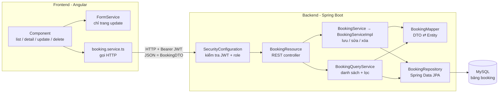
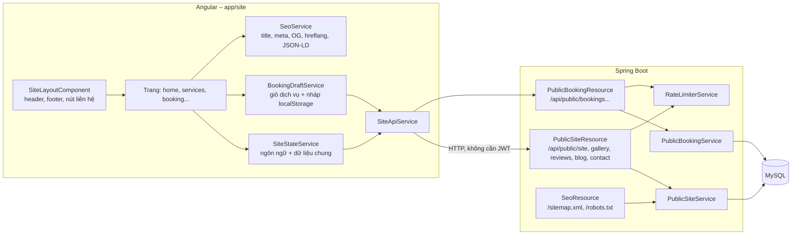

# 02. Luồng xử lý Thêm / Sửa / Xóa / Xem — code đi từ đâu đến đâu

Tài liệu này mô tả đường đi của một request từ giao diện Angular xuống database và ngược lại.
Mọi entity đều theo **cùng một khuôn** (do JHipster sinh), ví dụ dưới đây dùng `Booking`; thay tên là áp dụng cho entity khác.

## 1. Bức tranh tổng thể



| Tầng            | Vị trí                                                                             | Nhiệm vụ                                                             | Không được làm                                          |
| --------------- | ---------------------------------------------------------------------------------- | -------------------------------------------------------------------- | ------------------------------------------------------- |
| Component       | `src/main/webapp/app/entities/booking/{list,detail,update,delete}/`                | Hiển thị, nhận thao tác người dùng                                   | Gọi `HttpClient` trực tiếp                              |
| Angular service | `entities/booking/service/booking.service.ts`                                      | Gọi REST `api/bookings`, chuyển ngày giờ `dayjs` ⇄ chuỗi ISO         | Chứa logic giao diện                                    |
| Resource        | `web/rest/BookingResource.java`                                                    | Nhận HTTP, kiểm tra id, **kiểm tra quyền theo dữ liệu**, trả mã HTTP | Gọi thẳng `Repository` để ghi, chứa logic nghiệp vụ dài |
| QueryService    | `service/BookingQueryService.java`                                                 | Dựng `Specification` từ `BookingCriteria` để lọc + phân trang        | Ghi dữ liệu                                             |
| Service         | `service/BookingService.java` (interface) + `service/impl/BookingServiceImpl.java` | Nghiệp vụ, `@Transactional`                                          | Biết về HTTP                                            |
| Mapper          | `service/mapper/BookingMapper.java` (MapStruct, code sinh khi build)               | `BookingDTO` ⇄ `Booking`                                             | —                                                       |
| DTO             | `service/dto/BookingDTO.java`                                                      | Dữ liệu trao đổi với client, validation `@NotNull`, `@Size`…         | —                                                       |
| Entity          | `domain/Booking.java`                                                              | Ánh xạ bảng `booking` (JPA)                                          | Trả thẳng ra API                                        |
| Repository      | `repository/BookingRepository.java`                                                | Truy vấn DB                                                          | —                                                       |
| Schema          | `resources/config/liquibase/changelog/*_Booking.xml`                               | Tạo bảng, FK                                                         | Sửa changeset đã chạy                                   |

## 2. Từng thao tác

### 2.1 Xem danh sách (có lọc, phân trang)

```
list/booking.component.ts  → load() → bookingService.query({page, size, sort, 'status.equals': ...})
  → GET /api/bookings?page=0&size=20&sort=id,asc&status.equals=PENDING
BookingResource.getAllBookings(BookingCriteria criteria, Pageable pageable)
  ├─ [riêng Booking] nếu chỉ là CUSTOMER → ép criteria.customerId = khách đang đăng nhập
  └─ BookingQueryService.findByCriteria(criteria, pageable)
       → createSpecification(criteria) → bookingRepository.findAll(spec, page)
       → map(bookingMapper::toDto)
  ← 200 + body List<BookingDTO> + header X-Total-Count, Link (phân trang)
```

- Tham số lọc có dạng `<field>.<toán tử>`: `equals`, `notEquals`, `in`, `contains`, `greaterThan`, `lessThanOrEqual`, `specified`…
  Ví dụ: `GET /api/spa-services?active.equals=true&categoryId.equals=3&price.lessThan=500000`
- Đếm: `GET /api/bookings/count?...` → `countBookings`.

### 2.2 Xem chi tiết

```
route/booking-routing-resolve.service.ts → bookingService.find(id)   (chạy TRƯỚC khi mở trang)
  → GET /api/bookings/{id}
BookingResource.getBooking(id)
  → bookingService.findOne(id) → bookingRepository.findOneWithEagerRelationships(id) → toDto
  ├─ [riêng Booking] CUSTOMER xem lịch của người khác → trả 404
  ← 200 BookingDTO | 404
detail/booking-detail.component.ts hiển thị
```

### 2.3 Thêm mới

```
update/booking-update.component.ts
  ├─ ngOnInit: tải danh sách cho dropdown (promotionService.query(), customerService.query())
  ├─ BookingFormService.createBookingFormGroup()  → form + validator (required, maxlength…)
  └─ save(): formService.getBooking(form) → bookingService.create(booking)
  → POST /api/bookings   body: BookingDTO (id = null)
SecurityConfiguration: có role ADMIN/STAFF/CUSTOMER?  (không → 401/403)
@Valid BookingDTO: sai validation → 400 kèm danh sách fieldErrors
BookingResource.createBooking(dto)
  ├─ dto.id != null → 400 "idexists"
  ├─ [riêng Booking] CUSTOMER → gán customer = chính mình, status = PENDING,
  │                          paymentStatus = UNPAID, bỏ totalAmount/discountAmount
  └─ bookingService.save(dto)
       → bookingMapper.toEntity(dto) → bookingRepository.save(entity) → bookingMapper.toDto
  ← 201 Created, header Location: /api/bookings/{id}, header thông báo (alert)
Angular: hiện thông báo thành công, quay về trang trước
```

### 2.4 Sửa toàn bộ (PUT) / sửa một phần (PATCH)

```
update component (có id) → bookingService.update(booking)
  → PUT /api/bookings/{id}       body: BookingDTO đầy đủ
BookingResource.updateBooking(id, dto)
  ├─ dto.id == null → 400 "idnull"
  ├─ id URL ≠ dto.id → 400 "idinvalid"
  ├─ không tồn tại → 400 "idnotfound"
  └─ bookingService.update(dto) → toEntity → save → toDto
  ← 200 BookingDTO
```

- **PUT** ghi đè mọi cột: trường nào client gửi `null` sẽ thành `null` trong DB.
- **PATCH** (`Content-Type: application/merge-patch+json`) chỉ ghi trường khác `null`:
  `bookingService.partialUpdate` → `findById` → `bookingMapper.partialUpdate(entity, dto)` → `save`.
- Giao diện mặc định dùng PUT.

### 2.5 Xóa

```
delete/booking-delete-dialog.component.ts → confirmDelete(id) → bookingService.delete(id)
  → DELETE /api/bookings/{id}
BookingResource.deleteBooking(id) → bookingService.delete(id) → bookingRepository.deleteById(id)
  ← 204 No Content
```

- Không có cascade: còn `booking_item` tham chiếu → lỗi khóa ngoại. Xem bảng "Lưu ý khi xóa" trong [01-database-va-phan-quyen.md](01-database-va-phan-quyen.md#lưu-ý-khi-xóa-không-có-cascade).

### 2.6 Lỗi trả về client

Mọi exception đi qua [`ExceptionTranslator`](../src/main/java/com/mycompany/myapp/web/rest/errors/ExceptionTranslator.java) và trả JSON dạng `application/problem+json`:

| Tình huống                                    | HTTP | Ghi chú                                                                                                                |
| --------------------------------------------- | ---- | ---------------------------------------------------------------------------------------------------------------------- |
| Chưa đăng nhập / token hết hạn                | 401  | Angular tự chuyển về trang login                                                                                       |
| Thiếu role                                    | 403  | API: Angular hiện thông báo lỗi; route bị `UserRouteAccessService` chặn → trang "accessdenied"                         |
| Sai validation DTO                            | 400  | `fieldErrors` liệt kê từng trường                                                                                      |
| `BadRequestAlertException`                    | 400  | `errorKey` (vd `idexists`, `nocustomerprofile`) → dịch qua i18n `error.<errorKey>`                                     |
| Không tìm thấy                                | 404  |                                                                                                                        |
| Vi phạm khóa ngoại / unique                   | 500  | Vd xóa bản ghi cha, trùng `phone`, `slug`, `code` — nên kiểm tra trước trong Service và ném `BadRequestAlertException` |
| Sửa đồng thời (`ConcurrencyFailureException`) | 409  |                                                                                                                        |

## 3. Bản đồ file theo entity

| Entity            | URL API                   | Thư mục Angular             | Logic riêng ngoài code sinh                                                                            |
| ----------------- | ------------------------- | --------------------------- | ------------------------------------------------------------------------------------------------------ |
| `ServiceCategory` | `/api/service-categories` | `entities/service-category` | —                                                                                                      |
| `SpaService`      | `/api/spa-services`       | `entities/spa-service`      | —                                                                                                      |
| `Customer`        | `/api/customers`          | `entities/customer`         | `CustomerRepository.findOneByUserLogin` (tìm hồ sơ theo tài khoản)                                     |
| `Staff`           | `/api/staff`              | `entities/staff`            | Có `StaffRepositoryWithBagRelationships` để tải ManyToMany `services`                                  |
| `Booking`         | `/api/bookings`           | `entities/booking`          | `BookingResource`: `isCustomerOnly()`, `currentCustomerId()`, lọc & ép dữ liệu cho CUSTOMER            |
| `BookingItem`     | `/api/booking-items`      | `entities/booking-item`     | —                                                                                                      |
| `Promotion`       | `/api/promotions`         | `entities/promotion`        | —                                                                                                      |
| `Review`          | `/api/reviews`            | `entities/review`           | `ReviewResource`: non-ADMIN chỉ xem `approved = true`; CUSTOMER tạo → tự gán khách, `approved = false` |
| `ContactMessage`  | `/api/contact-messages`   | `entities/contact-message`  | —                                                                                                      |
| `SiteSetting`     | `/api/site-settings`      | `entities/site-setting`     | Website chỉ dùng **bản ghi đầu tiên** (`SiteSettingRepository.findFirstByOrderByIdAsc`)                |
| `Branch`          | `/api/branches`           | `entities/branch`           | `capacity`, giờ mở cửa dùng để tính khung giờ đặt lịch                                                 |
| `GalleryImage`    | `/api/gallery-images`     | `entities/gallery-image`    | Form tự điền `width/height` khi upload ảnh                                                             |
| `BlogPost`        | `/api/blog-posts`         | `entities/blog-post`        | Website chỉ đọc bài `published = true` qua `/api/public/blog`                                          |

Các file Java của một entity `X` (gói `com.mycompany.myapp`):

```
domain/X.java                         Entity JPA
repository/XRepository.java           Truy vấn DB
service/XService.java                 Interface nghiệp vụ
service/impl/XServiceImpl.java        Cài đặt nghiệp vụ (@Transactional)
service/XQueryService.java            Lọc + phân trang theo criteria
service/criteria/XCriteria.java       Tham số lọc
service/dto/XDTO.java                 Dữ liệu trao đổi + validation
service/mapper/XMapper.java           MapStruct DTO ⇄ Entity
web/rest/XResource.java               REST controller
```

Test tương ứng: `src/test/java/.../web/rest/XResourceIT.java`, `domain/XTest.java`, `service/dto/XDTOTest.java`, `service/mapper/XMapperTest.java`; Angular `*.spec.ts` cạnh từng component.

## 4. Website khách (/vi, /en)

### 4.1 Tổng thể



| Bước                 | Chuyện gì xảy ra                                                                                                                                                                                            |
| -------------------- | ----------------------------------------------------------------------------------------------------------------------------------------------------------------------------------------------------------- |
| Mở `/`               | `app.routes.ts` chuyển tới `/vi` hoặc `/en` (theo lựa chọn trước đó / ngôn ngữ trình duyệt)                                                                                                                 |
| Mở `/vi/...`         | Route `:lang` (chỉ khớp `vi`/`en`) tải lazy `site/site.routes.ts`; `MainComponent` ẩn navbar/footer quản trị                                                                                                |
| Trước khi hiện trang | `siteDataResolver` gọi `GET /api/public/site` **1 lần** → cài đặt, cơ sở, danh mục, dịch vụ đang bật (cache 1 phút)                                                                                         |
| Đổi ngôn ngữ         | `SiteLayoutComponent` đọc `:lang` → `SiteStateService.setLang()` → `translate.use()` (chuỗi giao diện trong `i18n/{vi,en}/site.json`), dữ liệu song ngữ lấy bằng `state.t(obj, 'name')` → `nameVi`/`nameEn` |
| SEO                  | Mỗi trang gọi `SeoService.set(...)` trong `effect` → `<title>`, description, Open Graph, canonical, `hreflang`, JSON-LD (`DaySpa`, `Service`+`Offer`, `Review`, `BlogPosting`)                              |

### 4.2 Đặt lịch (7 bước)

```
BookingComponent (app/site/pages/booking)
  bước 1 Cơ sở ─ 2 Dịch vụ ─ 3 Ngày ─ 4 Giờ ─ 5 Số người ─ 6 Thông tin ─ 7 Xác nhận
  ├─ mọi lựa chọn ghi vào BookingDraftService.draft (signal) → effect lưu localStorage 'site.bookingDraft'
  ├─ maxReachable = bước đầu tiên chưa hợp lệ → thanh tiến trình chỉ cho bấm tới đó, quay lại không mất dữ liệu
  ├─ cơ sở/ngày/thời lượng/số người đổi → GET /api/public/bookings/availability?branchId&date&duration&people
  │     PublicBookingService.availability(): sinh khung 15', đánh dấu AVAILABLE / FULL / PAST
  │     giờ đã chọn không còn AVAILABLE → tự bỏ chọn
  └─ bước 7: POST /api/public/bookings  {branchId, serviceIds, date, time, numberOfPeople, fullName, phone, email, note, quick, website}
        PublicBookingResource: honeypot `website` → 400; RateLimiter 5/10'/IP → 429
        PublicBookingService.create() [synchronized, @Transactional]
          ├─ chuẩn hóa SĐT VN, kiểm tra ngày/giờ/khung còn chỗ (lỗi → 400 error.<key>)
          ├─ tìm/tạo Customer theo SĐT
          ├─ lưu Booking (code, PENDING, UNPAID, source) + BookingItem cho từng dịch vụ, tổng tiền tính ở server
          └─ ← 201 BookingConfirmationDTO
  thành công → xóa nháp, hiện mã + tóm tắt, nút .ics (bookingIcs()), WhatsApp (wa.me?text=), Zalo (copy + mở zalo.me)
  lỗi slotfull/pasttime → tải lại khung giờ, đưa khách về bước 4
```

**Đặt nhanh** (`/vi/booking?mode=quick`): 1 form gồm dịch vụ + ngày + giờ + SĐT, cơ sở = cơ sở đầu tiên, `quick=true`, số người = 1, họ tên có thể trống (server lưu tên = SĐT).

**Tra cứu** (`/vi/booking/lookup`): `POST /api/public/bookings/lookup {code, phone}` → chỉ trả khi SĐT khớp khách của lịch (404 nếu sai). Dùng POST để SĐT không nằm trong URL/log.

Mã lỗi server (`message: "error.<key>"`) ↔ thông báo trong `site.json` (`site.booking.apiErrors.<key>`):
`slotfull`, `pasttime`, `pastdate`, `datetoofar`, `invalidphone`, `namerequired`, `servicenotfound`, `branchnotfound`, `invalidtime`, `spam`.

### 4.3 Upload ảnh ở trang quản trị

```
Form quản trị (vd spa-service-update) → <jhi-image-upload [control]="editForm.controls.imageUrl">
  ├─ trình duyệt đọc ảnh → canvas → WebP 1600px, 800px, 24px
  ├─ POST /api/admin/uploads (multipart: image, medium, placeholder) — chỉ ROLE_ADMIN
  │     UploadResource: kiểm tra "magic bytes" (WebP/AVIF/JPEG/PNG), lưu {upload-dir}/yyyy/MM/<uuid>.webp, <uuid>-800.webp, <uuid>-24.webp
  │     ← { url: "/uploads/2026/10/<uuid>.webp", ... }
  └─ ghi url vào form → bấm Lưu như bình thường
Website: <site-image [url]> → imageSet(url) suy ra srcset 800w/1600w + ảnh 24px làm nền mờ; lazy loading; khung tỷ lệ cố định
Phục vụ ảnh: UploadWebConfiguration map /uploads/** → thư mục application.upload-dir, cache 1 năm (tên file UUID không đổi)
```

## 5. Quy trình khi thay đổi

### 5.1 Thêm / sửa trường, thêm entity, thêm quan hệ

1. Sửa [`jhipster-jdl.jdl`](../jhipster-jdl.jdl).
2. Chạy `npx jhipster jdl jhipster-jdl.jdl` → JHipster sinh lại entity, DTO, mapper, Angular, **thêm changeset Liquibase mới**.
3. Khi hỏi ghi đè: xem kỹ các file đã sửa tay (`BookingResource`, `ReviewResource`, `CustomerRepository`, `SecurityConfiguration`, `entity.routes.ts`, `navbar.component.html`) — chọn **không ghi đè** hoặc ghi đè rồi dùng `git diff` để chép lại phần đã sửa.
4. Dev: Liquibase chạy khi khởi động app. Nếu báo lỗi checksum do JHipster sửa changeset cũ → với DB dev có thể xóa DB `aulacswsc` để tạo lại; **không làm vậy với DB thật**, hãy viết changeset mới.

### 5.2 Thêm logic nghiệp vụ

| Loại logic                                                      | Đặt ở                                                    |
| --------------------------------------------------------------- | -------------------------------------------------------- |
| Ai được gọi URL nào                                             | `SecurityConfiguration`                                  |
| Ai được thấy / sửa bản ghi nào (theo chủ sở hữu)                | `XResource` (như `BookingResource`) hoặc `XServiceImpl`  |
| Tính toán, kiểm tra nghiệp vụ (tổng tiền, trùng lịch, áp mã KM) | `XServiceImpl`                                           |
| Truy vấn đặc biệt                                               | Thêm method vào `XRepository`                            |
| API mới không phải CRUD (vd đặt lịch kèm dịch vụ)               | Resource mới + Service mới, không nhồi vào CRUD sinh sẵn |

### 5.3 Thay đổi schema thủ công

Không sửa changeset đã chạy. Tạo file mới `src/main/resources/config/liquibase/changelog/<yyyyMMddHHmmss>_<mô_tả>.xml` và include trong `master.xml` tại needle `jhipster-needle-liquibase-add-incremental-changelog` (ví dụ: `20261011120000_added_spa_authorities.xml`).
